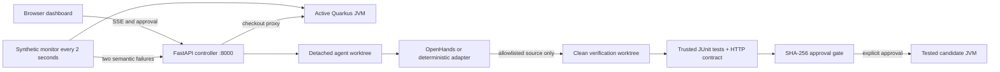

# Self-healing checkout lab

Demonstration for **macOS Apple Silicon, Java 27 and Python 3.12**. Quarkus checkout → synthetic monitor and log follower → FastAPI incident controller → OpenHands coding agent (triage, then fix) → independent verification → pull request and CI → human merge → recovered checkout. The target service is configurable in `target.json`. Everything binds to loopback. No Docker, Node, cloud deployment, or database required.

## Start in three steps

Prerequisites: Git, Homebrew, Maven, uv and a Java 27 JDK. On an Apple Silicon Mac:

```bash
brew install openjdk maven uv
export JAVA_HOME="$(brew --prefix openjdk)/libexec/openjdk.jdk/Contents/Home"
export PATH="$JAVA_HOME/bin:$PATH"
```

From this directory:

```bash
uv sync --frozen --python 3.12 --extra dev
./scripts/start.sh
```

Open **http://127.0.0.1:8000**. First startup downloads Maven dependencies; allow several minutes. Wait for `healthy`, then choose **Inject fault**. The failing request makes the service log an error, and that log line opens the incident. Read the triage diagnosis and the patch, wait for **awaiting approval**, and choose **Approve tested release** (with `PUBLISH_FIX=0`; otherwise merge the pull request). The same request then succeeds. **Reset demo** returns traffic to the original buggy service without modifying your source files.

Default `AGENT_MODE=deterministic` uses a known null-guard patch. This is explicitly labeled in the dashboard: it is **not an AI run**, but detection, isolated worktrees, Java builds, tests, approval, deployment and monitoring are all real. It needs no API key and is the recommended first smoke test.

## First end-to-end smoke test

With the server running, in another terminal:

```bash
.venv/bin/python scripts/smoke.py
.venv/bin/python -m pytest -q
```

The smoke test deliberately approves its test release. It checks the initial 500, detection, real repair and verification, a still-broken pre-approval service, a rejected wrong digest, successful approval, duplicate approval rejection, recovered checkout, metrics, SSE cursor resumption and reset to the initial 500. It refuses OpenHands mode to avoid starting a billable run inadvertently.

Manual requests:

```bash
curl -i http://127.0.0.1:8000/checkout -H 'Content-Type: application/json' -d '{"subtotalCents":10000}'
curl -N http://127.0.0.1:8000/api/events
curl http://127.0.0.1:8000/api/metrics
```

Health alone stays green despite the business failure. That contrast is intentional: readiness does not validate optional-coupon checkout behavior.

## Run the real OpenHands adapter

Stop the server with Ctrl-C. Install the pinned optional extra and configure your model provider:

```bash
uv sync --frozen --python 3.12 --extra dev --extra agent
export AGENT_MODE=openhands
# uses your Claude subscription: run `claude login` once (or set CLAUDE_CODE_OAUTH_TOKEN); needs Node/npx
export ACP_MODEL=sonnet   # optional
./scripts/start.sh
```

The adapter uses the OpenHands SDK's `ACPAgent` (Claude Code via `claude-agent-acp`) in a `LocalConversation`, with a 600-second process timeout. Authentication comes from your Claude subscription login; never put tokens into Git. Claude Code brings its own tools (including shell), so the file-only restriction no longer applies at the agent level; safety rests on the detached worktree and the allowlisted Java-file import below.

The agent receives the newest exception from the service log (or from `POST /api/alert`). It first triages read-only and writes a root-cause diagnosis (`FIXABLE: yes/no`), then fixes. After verification the engine pushes `self-heal/<incident>`, opens a PR (CI: `.github/workflows/ci.yml`); merging it deploys the fix. Set `PUBLISH_FIX=0` to skip the push/PR and approve in the dashboard instead. It edits a detached Git worktree, and the controller imports only the allowlisted source files (`allowed_root` and `allowed_suffixes` in `target.json`) into a **different** clean verification worktree. It never executes build configuration or tests supplied by the agent. Agent logs are local under `.state/agent-<incident>.log`.

An actual model run needs your credentials and incurs provider charges. The deterministic run validates the same downstream repair pipeline. Do not describe it as evidence of model quality.

## Presentation fallback

For a fully dependency-light fallback (no Java, Maven or model calls after Python dependencies are installed):

```bash
AGENT_MODE=replay ./scripts/start.sh
```

Inject, inspect the illustrative timeline, and approve. The dashboard prominently says **REPLAY · SIMULATED**, all narrative events say simulated, and `/checkout` returns 503 because no Java service exists. This plays the bundled scenario; it is not a recording of a real AI run. The same smoke command checks the replay gate and SSE stream. To switch adapters, stop and restart; there is no silent fallback after a failed agent run.

## Architecture and trust boundaries



* Source baseline: `service/`; its optional-coupon null dereference is deliberate. Valid coupon traffic succeeds until synthetic traffic switches to null. Money uses integer cents; SAVE10 applies a 10% discount, rounded down to cents.
* Incident state: one active cycle. An error line in the service log (or an `/api/alert` call) opens a single incident; the probe records the failing request for verification. Infrastructure connectivity failures are reported separately and do not trigger the source-bug repair.
* Isolation: `.state/repo-*` is a private repository; the user's Git repo is never reset or merged. `.state/agent-*` and `.state/verify-*` are separate detached worktrees. Only added or modified files matching the allowlist in `target.json` (default: `.java` under `service/src/main/java/`, at most 5) may change. Source symlinks, extra tracked changes, and untracked additions are rejected.
* Trusted verification: existing baseline test + eight external JUnit contract tests copied by the controller, followed by eight real HTTP cases (missing/null/blank/unknown/valid/zero and invalid amounts). The external suite intentionally fails on the buggy baseline.
* Deployment: candidate starts on a separate loopback port. The public `/checkout` proxy keeps using the buggy baseline until approval matches both incident ID and the SHA-256 of all release files. It rechecks the digest and contract, switches traffic, then verifies again. Failure returns traffic to the previous service. By default the verified fix is pushed to a `self-heal/<incident>` branch and a pull request is opened; merging it is the approval. With `PUBLISH_FIX=0` nothing leaves the machine and approval happens in the dashboard.
* Approval API requires a per-session header token; browser mutations also check Origin. The server binds to loopback and validates Host. This is a single-user demonstration, not a multi-user authentication system.
* Git worktrees provide **checkout isolation, not an OS security sandbox**. The local agent runs with your account permissions, and Java source is executed during verification. File allowlisting does not make arbitrary malicious Java safe. Use this trusted fixture locally; deploy an agent-server/container boundary before adapting it to untrusted repositories.
* SSE includes event IDs, Last-Event-ID resume within a process, heartbeats and automatic browser reconnection. Events append to `.state/events.jsonl` for inspection; state and SSE cursors are process-local. A server restart always builds a fresh baseline rather than resuming an interrupted incident. There is no distributed locking or durable workflow recovery.
* Candidate JVMs and worktrees are retained for inspection until shutdown. Ctrl-C stops the child JVMs. Delete `.state/` **only after shutdown** to remove all logs/builds and cached Maven artifacts. Never expose this demo to a public interface.

## 25-minute session plan

| Time | Activity | Where |
|---|---|---|
| 0–4 min | Opening talk: what self-healing software is, and what this demo does and does not claim | Slides or talk, see "Opening talk" below |
| 4–7 min | Show the healthy dashboard; readiness stays green while only the business probe catches faults; architecture and the human gate | Dashboard, steps 1 |
| 7–10 min | **Inject fault**; watch the error in the service log open an incident | Steps 2–3 |
| 10–14 min | Triage card (root cause, `FIXABLE`), then the agent's fix, allowlist and separate verification | Steps 4–5 |
| 14–19 min | Pull request, CI, review and merge as the approval; deploy and live check | Steps 6–8 |
| 19–23 min | Reset; discuss rejection, rollback, trust boundaries and how this maps to production (Sentry + Seer, your own CI/CD) | Step 9, "Points worth stressing" |
| 23–25 min | Questions. If model latency threatens timing, switch to the replay fallback | `AGENT_MODE=replay` |

The opening talk, live script with talking points and troubleshooting are in [docs/demo-walkthrough.md](docs/demo-walkthrough.md).

Preflight: run the deterministic smoke test once to warm dependencies, run a real OpenHands cycle if presenting AI, reset, and keep a separate terminal ready for replay. Model output/latency cannot be guaranteed. Start with the deterministic adapter if internet is unreliable. `MONITOR_INTERVAL` controls the probe interval; `PORT` changes the dashboard port (pass `--url` to the smoke test).

## Files and troubleshooting

`orchestrator/engine.py` owns the lifecycle; `agent.py` is the SDK adapter; `app.py` exposes the API/SSE and checkout proxy; `dashboard/index.html` has no external assets. `verification/` is controller-owned test input. `tests/` checks approval, artifact tampering, rollback, rejection and deterministic patch behavior. `uv.lock` pins Python dependencies, and `service/pom.xml` pins the Java build platform/plugins.

If startup fails, inspect `.state/commands.log` and `.state/app-*.log`. Ensure `java -version` reports 27 and Maven uses the same JDK. First dependency resolution requires network access. If port 8000 is occupied, use `PORT=8005`. A failed candidate never becomes active; inspect logs, then Reset to retry. An unavailable baseline requires fixing startup and restarting. Do not run two controllers in the same extracted directory.

SDK reference: https://github.com/OpenHands/software-agent-sdk (official quick start). Quarkus reference: https://quarkus.io/guides/getting-started . See `VERIFICATION.md` for the checks actually executed for this delivery.
