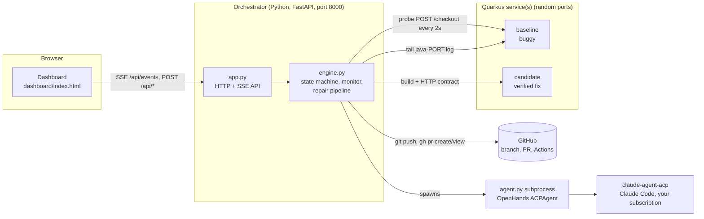

# Architecture

## Components

| Component | Where | Role |
|---|---|---|
| Quarkus service | `service/` | The real REST API. `CheckoutResource` holds the deliberate bug (`order.coupon().trim()` without a null check). Access logging is on, so every request appears in its log. |
| Orchestrator API | `orchestrator/app.py` | Serves the dashboard, the SSE event stream, control endpoints (`inject`, `reset`, `approve`, `reject`), and a `/checkout` proxy that forwards to whichever service is currently *active*. |
| Engine | `orchestrator/engine.py` | All logic: build/launch Java, monitor, log tailing, repair pipeline, verification, PR publishing, merge watching, deployment switch. |
| Agent | `orchestrator/agent.py` | A subprocess run once per incident, 600 s timeout. Modes: `openhands` (general autonomous agent via ACPAgent, fixes whatever the log shows), `deterministic` (canned fixture for the coupon bug, no AI), `replay` (no execution at all). |
| Verification | `verification/CheckoutContractTest.java` | Trusted JUnit tests injected into the verification checkout. The agent never controls them. |
| CI | `.github/workflows/ci.yml` | Same safety net again on GitHub: build, contract tests, start the app, curl it. |
| Dashboard | `dashboard/index.html` | Vanilla JS. Renders state, shows the live Quarkus log, the patch, PR link and CI state. |

## Processes and ports

- **Orchestrator**: one uvicorn process, `127.0.0.1:8000` (`PORT` to change).
- **Quarkus**: one `java -jar quarkus-run.jar` process per launch, each on a free port (`free_port()`): the baseline at startup, the candidate during verification. Each writes `.state/java-<port>.log`.
- **Agent**: `python -m orchestrator.agent <worktree> <mode> <exception-log>` per incident. In `openhands` mode it starts `npx -y @agentclientprotocol/claude-agent-acp`, which uses your local `claude login` session.
- **Active service**: `engine.active` is the URL traffic goes to. Deployment is just reassigning this pointer after checks pass. The dashboard's `/checkout` proxy and the probe monitor follow it.

## Working directories (all under `.state/`, gitignored)

| Path | Contents |
|---|---|
| `repo-<id>/` | Private Git repo created from a copy of `service/`. Branch `demo`, one commit (the buggy baseline). Keeps the user's own checkout untouched. |
| `agent-<incident>/` | Detached worktree of the baseline. The only place the agent writes. |
| `verify-<incident>/` | Second detached worktree. Only the agent's single source file is copied in, plus the trusted contract test. Built and run from here. |
| `publish-<incident>/` | Temporary worktree of the *real* repo (`main`) used to commit and push the fix. Removed afterwards. |
| `java-<port>.log` | Quarkus stdout/stderr. Source for the dashboard log card and for the agent's diagnosis. |
| `exception-<incident>.log` | The ERROR block handed to the agent. |
| `agent-<incident>.log` | Agent subprocess output. First place to look if repair fails. |
| `events.jsonl` | Every event ever emitted (also streamed over SSE). |
| `commands.log`, `m2/` | Command transcripts, isolated Maven repository. |

## API surface

| Endpoint | Purpose |
|---|---|
| `GET /` | Dashboard (`Cache-Control: no-store`) |
| `GET /api/state` | Snapshot: status, mode, incident, patch, digest, probe, live check, PR, CI |
| `GET /api/events` | SSE stream, resumable with `Last-Event-ID` |
| `GET /api/session` | Session token for non-browser clients |
| `POST /api/inject` `reset` `reject` `approve` | Control actions (see [safety](safety-and-limits.md) for protection) |
| `POST /checkout`, `GET /api/metrics` | Proxies to the active Quarkus service |

## Configuration

| Variable | Default | Meaning |
|---|---|---|
| `AGENT_MODE` | `deterministic` | `deterministic`, `openhands`, or `replay` |
| `ACP_MODEL` | server default | Model for Claude Code, e.g. `sonnet` |
| `PUBLISH_FIX` | `1` | `0` skips branch/PR and falls back to dashboard approval |
| `MONITOR_INTERVAL` | `2` | Seconds between synthetic probes |
| `DEMO_TOKEN` | random | Fixed session token (mostly for scripts) |
| `PORT` | `8000` | Orchestrator port |

## Technology choices

- Java 27 runtime, `maven.compiler.release=25`, Quarkus, built with Maven.
- Python 3.12, FastAPI, httpx, OpenHands SDK 1.61 (`LocalConversation` + `ACPAgent`).
- `git worktree` for cheap isolated checkouts; `gh` CLI for PRs.
- Server-sent events instead of WebSockets: one-directional, auto-reconnect, no extra dependency.
